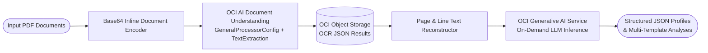

# OCI Document Understanding & Generative AI Document Pipeline

> **Automated PDF OCR Extraction & Structured AI Analysis Powered by Oracle Cloud Infrastructure**  
> Built with **OCI AI Document Understanding**, **OCI Generative AI**, and **OCI Object Storage**.  
> **Author:** Abdallah AlNsour (*Oracle ACE Apprentice*, *OCI Certified Enterprise AI Professional*, *Agentic AI for Oracle AI Database Certified Professional*)

---

## 📖 Overview

This repository demonstrates an end-to-end document intelligence pipeline built natively on **Oracle Cloud Infrastructure (OCI)** AI Services. It combines **OCI AI Document Understanding** for high-accuracy OCR extraction from PDF documents with **OCI Generative AI** for structured JSON schema generation, skill extraction, and multi-perspective document analysis.

---

## 🏗️ Architecture



---

## 🚀 Key Capabilities

* **OCI AI Document Understanding (`DocUnderStanding.py` & `unified_cv_processor.py`):**
  * Submits asynchronous OCR processor jobs via `AIServiceDocumentClient` and `AIServiceDocumentClientCompositeOperations` (`DocumentTextExtractionFeature` + `GeneralProcessorConfig`).
  * Retrieves structured page-by-page, line-by-line JSON output directly from **OCI Object Storage**.
* **OCI Generative AI Structured Analysis (`genAI.py` & `json_cv_analyzer.py`):**
  * Pipes extracted document text into `GenerativeAiInferenceClient` (`GenericChatRequest`, `OnDemandServingMode`) using specialized prompt templates:
    * `cv_json_analysis`: Strict JSON extraction (personal info, work experience, education, technical/soft skills, certifications, projects).
    * `cv_analysis`: Comprehensive human-readable summary.
    * `skills_extraction`: Categorized technical & soft skill inventory.
    * `experience_summary`: Career trajectory and duration synthesis.
* **Batch & Single-Document Workflows (`unified_cv_processor.py` & `example_usage.py`):**
  * Supports single-file processing, batch folder processing, test-mode throttling, and extensible custom prompt templates.

---

## 📂 Project Structure

```
oci-doc-understanding-genai/
├── .env.example              # Environment configuration template
├── .gitignore                # Excludes credentials, keys, and local PDFs
├── requirements.txt          # Python SDK dependencies
├── DocUnderStanding.py       # Standalone OCI Document Understanding OCR job runner
├── genAI.py                  # Standalone OCI Generative AI prompt & JSON analyzer
├── unified_cv_processor.py   # End-to-end Document Understanding + GenAI pipeline
├── json_cv_analyzer.py       # Structured JSON parsing & validation helpers
├── example_usage.py          # Single-file, batch, and custom prompt examples
├── simple_ai_test.py         # Quick OCI Generative AI inference smoke test
├── test_ai_analysis.py       # Template analysis validation test
└── README.md                 # Project documentation
```

---

## ⚡ Quick Start

### 1. Prerequisites
* Python 3.9+
* An Oracle Cloud Infrastructure (OCI) tenancy with IAM policies enabling:
  * `ai-document-family` (OCI Document Understanding)
  * `generative-ai-family` (OCI Generative AI)
  * `object-family` (OCI Object Storage)

### 2. Installation
```bash
git clone https://github.com/abdnsour/oci-doc-understanding-genai.git
cd oci-doc-understanding-genai

python -m venv venv
# Windows:
venv\Scripts\activate
# Linux/macOS:
source venv/bin/activate

pip install -r requirements.txt
```

### 3. Configuration
Copy `.env.example` to `.env` and populate your OCI compartment, Object Storage namespace/bucket, and Generative AI model OCID:
```bash
cp .env.example .env
```

### 4. Usage

#### Run the Full Unified Pipeline (OCR + GenAI):
Place sample PDF documents in `./sample_documents/` and execute:
```bash
python unified_cv_processor.py
```

#### Programmatic Usage:
```python
from unified_cv_processor import UnifiedCVProcessor

processor = UnifiedCVProcessor()

# Process a single PDF document
result = processor.process_single_cv(
    pdf_file="./sample_documents/sample_cv.pdf",
    analysis_types=["cv_analysis", "skills_extraction"]
)

# Batch process a directory of PDFs
results = processor.process_multiple_cvs(
    cv_directory="./sample_documents",
    test_mode=True
)
```

---

## 👤 Author

* **Abdallah AlNsour**
* Oracle ACE Apprentice
* OCI Certified Enterprise AI Professional
* Agentic AI for Oracle AI Database Certified Professional
* GitHub: [@abdnsour](https://github.com/abdnsour)
